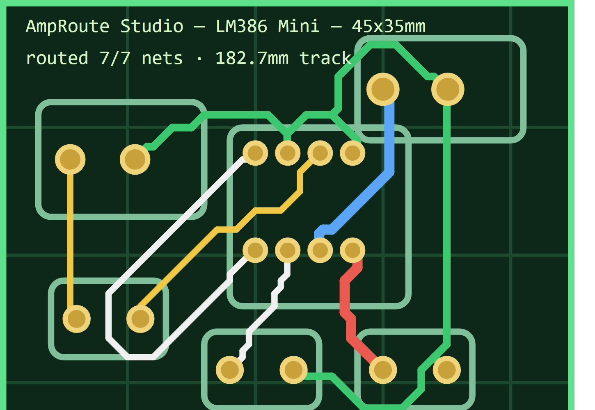

# AmpRoute Studio 2.0

**Agent-first autorouter and 2-D board editor for LUT audio-amplifier PCBs.**

An AI agent invents a circuit and describes a board; AmpRoute turns it into a
DRC-clean, manufacturable PCB with Gerbers, a 1:1 toner-transfer template and
official CAM files. A human opens the same board in a familiar KiCad-like
editor. No KiCad plugin, no Python runtime, no external services.



---

## 60-second start

```powershell
cargo build --release           # target\release\amproute-studio.exe
.\target\release\amproute-studio.exe
```

GUI: **Open board…** → pick `.kicad_pcb` or JSON → **F5** → choose
**Export folder…** → **Ctrl+E**. No board is preloaded: the shipped amplifiers
are test fixtures, not presets.

Headless:

```powershell
# Route one of the five shipped test boards
.\amproute-studio.exe --cli --board lm386-mini -o out --json

# Route an agent-designed board
.\amproute-studio.exe --cli -i my_board.json -o out --json

# Two-layer variant with plated vias
.\amproute-studio.exe --cli -i my_board.json --two-layer -o out2 --json

# Official CAM formats (from KiCad's own exporters)
.\amproute-studio.exe --cli -i my_board.json --odb --ipc -o cam

# Machine-readable agent interface
cargo build --release --bin amproute-mcp
```

Exit codes: `0` success, `2` invalid board, `3` routing/export refused.

---

## What it does

| Stage | Implementation |
|-------|----------------|
| **Import** | `.kicad_pcb` and AmpRoute JSON; rotates footprints correctly; reports every skipped KiCad feature. |
| **Rules** | `R01`–`R11`: LUT feature band, vias, width, clearance, net class, acute corners, parallel runs, annular ring, drill, edge clearance. |
| **Placement** | Opt-in 180° footprint optimizer (`--optimize-placement`, MCP `optimize_placement`). |
| **Routing** | 8-connected/octile A* with exact-mm `Occupancy`, audio proximity penalties, star-ground and thermal zones, rip-up/reroute, line-of-sight simplification, 45° canonicalisation and LUT width taper. |
| **Verification** | Own audit + `kicad-cli pcb drc --severity-all`; 15 reference boards at 100 % routing with zero violations. |
| **Quality** | DC drop, I²R, IPC-2221 width, linear AC (MNA), EMI/crosstalk proxies, transient thermal — all versioned JSON. |
| **Export** | Gerber, SVG, PDF, 1:1 LUT template (front and mirrored back), `.kicad_pcb`, Excellon drill, IPC-2581 Rev C, ODB++ zip. |
| **Agents** | CLI `--json` (one document on stdout) and MCP JSON-RPC 2.0 over stdio. |

### Agent workflow

1. Agent creates a board (JSON or `.kicad_pcb`) — no GUI needed.
2. `route_board` validates, routes, audits and writes every deliverable.
3. `get_result` returns nets, DRC, measurements, quality verdict and exact file paths.
4. Human prints `lut_print.pdf` at 100 %, transfers toner, etches and solders.

Ten agent-designed boards are built in (`pam8403-mini`, `lm358-preamp`,
`tda2822-bridge`, `ne555-tone`, `classa-single`, `jfet-buffer`,
`discrete-opamp`, `lm1875-mono`, `ta2024-tripath`, `hybrid-output`) alongside
five shipped fixtures (`lm386-mini`, `tda2030-compact`, `cmoy-headphone`,
`classic-ltp`, `twin-pair-200`). All 15 route 100 % with KiCad DRC clean.

### Audio-specific routing

- Net classes set width, priority and routing cost (GND/PWR first, sensitive
  inputs short and direct).
- Input↔Power/Output proximity penalty ×10; Feedback↔Output/Power ×5.
- Star-ground bias (`board.rs::star_ground_point`) and thermal hotspot keep-outs.
- Single-layer LUT by default: vias forbidden, insulated-wire jumpers instead.
- Two-layer mode adds plated vias, B.Cu Gerber, mirrored B.Cu LUT sheet and drill.

---

## GUI

Familiar EDA layout: menu bar, toolbars, appearance/net/component tree, board
canvas, inspector, DRC and statistics, status bar.

- Zoom with the wheel, pan by drag, rotate with `R`/`Shift+R`, mirror with `F`.
- Click a pad, track, component or net to inspect it.
- Toggle layers, keep-outs and thermal heatmap.
- `F5` route, `Esc` stop, `Ctrl+O` open, `Ctrl+K` KiCad export, `Ctrl+E` all exports.
- Routing runs on a worker thread — the UI stays responsive.

---

## Machine interface

CLI `--json` prints exactly one `PipelineResult` JSON document; diagnostics go
to stderr. MCP server:

| Tool | Purpose |
|------|---------|
| `get_capabilities`, `get_quality_schema` | API version, formats, analysis schema |
| `list_boards`, `list_extra_boards` | Fixtures and agent designs |
| `validate_board`, `run_drc` | Pre-flight checks |
| `route_board`, `get_result` | Route, export and retrieve the full report |
| `run_ac`, `generate_netlist`, `run_emi`, `run_thermal` | Proxy analyses |
| `optimize_placement`, `set_lut_profile`, `suggest_jumpers` | Agent helpers |

Full contract: [`docs/agent-api.md`](docs/agent-api.md).

### Quality verdict

`quality` is separate from manufacturability. Hard gates: all nets routed,
rules clean, own DRC clean, KiCad DRC clean, exports written. Electrical,
AC, EMI and thermal verdicts gate `ok` only when the agent supplies data and
selects them through `analysis_policy`. All proxy reports carry `model`,
`confidence` and `assumptions`.

History and comparisons: [`docs/quality-roadmap.md`](docs/quality-roadmap.md),
[`docs/router-roadmap.md`](docs/router-roadmap.md).

---

## Output files

| File | Purpose |
|------|---------|
| `board.gbr`, `board_b.gbr` | RS-274X copper layers, 4.6 format, millimetres |
| `board.svg` | Colour preview |
| `board.pdf` | Route report |
| `lut_print.pdf`, `lut_print_b.pdf` | 1:1 iron-on templates, front/mirrored back — print at 100 % |
| `<board>.kicad_pcb` | KiCad project board |
| `vias.drl` | Excellon drill for plated vias |
| `jumpers.csv` | Insulated-wire jumper endpoints |
| `board.xml` | IPC-2581 Rev C (KiCad exporter) |
| `board_odb.zip` | ODB++ (KiCad exporter) |

---

## Verification

```text
cargo test
  215 unit tests
  5-board acceptance + 10-board acceptance
  e2e, MCP, reference, quality, standards, SPICE golden
  → 0 failures

kicad-cli pcb drc --severity-all   # 0 violations on all 15 boards
lm386-mini: 7/7 nets, non_canonical segments = 0
```

The golden SPICE test runs only when `AMPROUTE_NGSPICE` points to a simulator;
otherwise it skips. KiCad 10 is used automatically for DRC and optional CAM.

---

## Project layout

```
src/
  agent.rs, bin/amproute-mcp.rs   MCP/JSON agent interface
  board.rs, boards.rs             Model, net classes, fixtures and agent designs
  import.rs, sexpr.rs, kicad.rs   KiCad round-trip
  router.rs, routing_engine.rs    A*, octile search, rip-up, canonicalisation
  occupancy.rs, two_layer.rs      Exact clearance, layered completion
  preroute.rs, jumper.rs          Star power/ground, insulated-wire jumpers
  rules.rs, drc.rs                LUT rules and DRC
  measure.rs, ac.rs, emi.rs       DC/AC/EMI quality proxies
  thermal.rs                      2-D conduction + transient estimate
  export.rs                       Gerber/SVG/PDF/LUT/CAM
  gui.rs, main.rs                 egui editor and CLI
tests/                             Acceptance and contract tests
docs/                               Agent API and roadmaps
```

---

## Limitations

- Through-hole only; two-layer vias are supported in the tool but require a
  manufactured two-layer board.
- KiCad import is deliberately partial (no zones, teardrops or custom pads);
  skipped features are reported.
- Thermal is a 2-D/RC proxy, AC is linear MNA, EMI is geometric — none is a
  full-wave or FEM solver.
- Always verify scale/orientation in an independent Gerber viewer before fab.

## Building

Rust 1.75+. On Linux install `libxkbcommon`, `libwayland-dev`, `libgl1-mesa-dev`.

```bash
cargo build --release
cargo test
```

## License

MIT — see [LICENSE](LICENSE).
